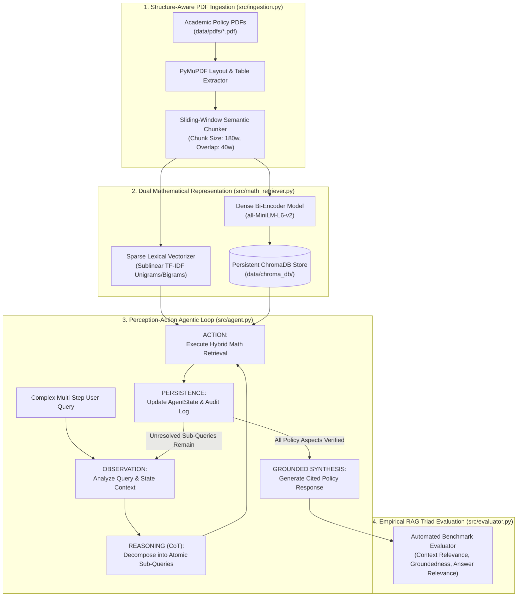

# Explainable Agentic RAG System: University Academic & Examination Policy Advisor

**Module:** DS205.3 – Data Science with Python  
**Domain:** Academic-Administration & Examination Regulatory Compliance  
**Python Version:** Python 3.10+  

---

## 1. Executive Summary & Problem Statement

Standard Large Language Models (LLMs) and out-of-the-box "black-box" Naïve Retrieval-Augmented Generation (RAG) pipelines suffer from two critical limitations in highly regulated domains such as **University Academic Administration**:
1. **Opaque Retrieval Mechanics:** Standard dense retrievers abstract away vector space mathematics, making it impossible to audit *why* a regulatory clause was selected or whether exact lexical identifiers (e.g., `DS205.3`, `Clause 4.1`, `3.70 GPA`) were matched.
2. **Single-Shot Failure on Multi-Hop Queries:** Complex student queries often span multiple regulatory documents simultaneously (e.g., combining coursework passing criteria with medical deferral rules), requiring iterative decomposition rather than single-shot retrieval.

This project implements a modular, object-oriented **Explainable Agentic RAG System** that bridges foundational text mathematics (**Sparse TF-IDF Vector Space Models**, **Dot Products**, **Euclidean $L_2$ Magnitudes**, **Cosine Similarity**) with modern **Dense Bi-Encoder Embeddings** and an explicit **Perception-Action Agentic Loop (`Observation -> Reasoning -> Action -> Persistence`)**.

---

## 2. System Architecture & Data Flow



---

## 3. Mathematical Foundations of the Hybrid Retrieval Pipeline

Rather than relying on an opaque similarity call, `HybridMathRetriever` (`src/math_retriever.py`) explicitly computes and logs foundational linear algebra operations for every candidate chunk:

### 3.1 Sparse Lexical Representation (TF-IDF)
For a term $t$ in document chunk $d$ across a corpus of $N$ chunks, the sublinear TF-IDF weight is computed as:

$$\text{tf-idf}(t, d) = \left(1 + \log \text{tf}(t, d)\right) \cdot \left(\log \frac{1 + N}{1 + \text{df}(t)} + 1\right)$$

The sparse lexical similarity $S_{\text{sparse}}(\mathbf{q}_s, \mathbf{d}_s)$ is obtained via the inner product of $L_2$-normalized TF-IDF vectors, and exact overlapping vocabulary tokens (`matched_terms`) are extracted for auditability.

### 3.2 Dense Vector Space Operations
Given a query embedding $\mathbf{q} \in \mathbb{R}^n$ and document chunk embedding $\mathbf{d} \in \mathbb{R}^n$:

**1. Raw Dot Product (Inner Product):**

$$\mathbf{q} \cdot \mathbf{d} = \sum_{i=1}^{n} q_i d_i$$

**2. Euclidean Vector Magnitude ($L_2$ Norm):**

$$\lVert \mathbf{q} \rVert_2 = \sqrt{\sum_{i=1}^{n} q_i^2}, \quad \lVert \mathbf{d} \rVert_2 = \sqrt{\sum_{i=1}^{n} d_i^2}$$

**3. Explicit $L_2$ Normalization & Cosine Similarity:**

$$S_{\text{dense}}(\mathbf{q}, \mathbf{d}) = \frac{\mathbf{q} \cdot \mathbf{d}}{\lVert \mathbf{q} \rVert_2 \cdot \lVert \mathbf{d} \rVert_2}$$

### 3.3 Convex Hybrid Score Fusion
To capture both semantic intent and exact regulatory clause numbers, the final ranking score combines dense and sparse similarities via a convex weighting parameter $\alpha \in [0, 1]$ (default $\alpha = 0.65$):

$$S_{\text{hybrid}}(q, d) = \alpha \cdot S_{\text{dense}}(\mathbf{q}, \mathbf{d}) + (1 - \alpha) \cdot S_{\text{sparse}}(\mathbf{q}_s, \mathbf{d}_s)$$

---

## 4. Modular OOP Architecture & Design Patterns

```text
explainable-agentic-rag/
├── data/
│   ├── pdfs/                       # Source University Academic & Examination Policy PDFs
│   ├── chroma_db/                  # Persistent ChromaDB vector store on disk
│   ├── ground_truth.json           # 10 Ground-Truth Q&A benchmark pairs
│   ├── evaluation_results.json     # Exported programmatic evaluation metrics
│   └── evaluation_table.md         # Exported Markdown table of RAG Triad scores
├── src/
│   ├── __init__.py
│   ├── interfaces.py               # Abstract Base Classes (ABCs) & Dataclass State Models
│   ├── ingestion.py                # PDFDocumentProcessor (Table-aware sliding-window chunker)
│   ├── math_retriever.py           # HybridMathRetriever (ChromaDB + Explicit Vector Math)
│   ├── agent.py                    # AcademicPolicyAgent (Observation -> Reasoning -> Action)
│   └── evaluator.py                # RAGEvaluator (Context Relevance, Groundedness, Answer Rel.)
├── main.py                         # CLI entry point & Deliverable D2 demo runner
├── evaluate.py                     # Automated 10-query benchmark runner
├── requirements.txt                # Reproducible Python package dependencies
├── .env.example                    # Environment configuration template
└── README.md                       # Architectural and mathematical documentation
```

### Applied Software Design Patterns
* **Strategy Pattern (`src/interfaces.py`):** `BaseDocumentProcessor`, `BaseRetriever`, `BaseAgent`, and `BaseEvaluator` define strict abstract contracts (`ABC`), enabling seamless swapping of chunking, retrieval, or evaluation algorithms.
* **Constructor Dependency Injection (`src/agent.py`):** `AcademicPolicyAgent` receives a `BaseRetriever` instance via its constructor rather than tightly coupling to a concrete database class.
* **State Pattern (`AgentState` & `AgentStep`):** Immutable/structured dataclasses track multi-hop observations, reasoning traces, deduplicated context chunks, and JSON audit persistence.

---

## 5. Reproducibility & Setup Instructions

### Step 1: Clone Repository & Create Virtual Environment
```powershell
git clone https://github.com/adeeshachathurmina-ux/explainable-agentic-rag.git
cd explainable-agentic-rag
python -m venv venv
.\venv\Scripts\activate
```

### Step 2: Install Dependencies
```powershell
pip install -r requirements.txt
```

### Step 3: Environment Configuration (Optional LLM Enhancement)
Copy `.env.example` to `.env` and add a Google Gemini API key if desired. *(Note: The system includes a built-in deterministic analytical synthesis fallback, so it runs 100% reproducibly even without an external API key).*
```powershell
copy .env.example .env
```

### Step 4: Run End-to-End Agentic Demonstration (Deliverable D2)
```powershell
python main.py --demo
```
Or launch the interactive advisor CLI:
```powershell
python main.py
```

### Step 5: Run Empirical Evaluation Benchmark (10 Ground-Truth Queries)
```powershell
python evaluate.py
```

---

## 6. Empirical Evaluation Summary (10 Ground-Truth Queries)

| ID | Ground-Truth Query | Context Relevance | Groundedness (Faithfulness) | Answer Relevance |
| :--- | :--- | :---: | :---: | :---: |
| GT_01 | What is the assessment weighting for module DS205.3 Data Science with Python and what is the maximum group size? | 0.8062 | 0.9298 | 0.6931 |
| GT_02 | What are the minimum passing criteria for a module under Clause 1.2? | 0.5709 | 0.9056 | 0.5479 |
| GT_03 | What Cumulative GPA is required for First Class Honours and Second Class Upper Division? | 0.8724 | 0.8986 | 0.8433 |
| GT_04 | Can a submission in DS205.3 achieve a Distinction grade without an objective evaluation framework? | 0.6229 | 0.9059 | 0.4210 |
| GT_05 | What is the mandatory attendance requirement under Clause 3.1 and what happens if a student falls below it? | 0.7087 | 0.8898 | 0.6453 |
| GT_06 | If a student passes coursework with 45% but misses the final examination due to certified illness, what is the medical deferral procedure? | 0.4733 | 0.8759 | 0.5700 |
| GT_07 | What is the maximum grade cap for a repeat examination under Clause 4.2? | 0.6071 | 0.8899 | 0.6610 |
| GT_08 | What happens if a group uploads all their Python code to GitHub in a single-push commit history? | 0.7104 | 0.8818 | 0.4677 |
| GT_09 | What are the technical architectural requirements for the DS205.3 Explainable Agentic RAG system? | 0.2961 | 0.9277 | 0.4864 |
| GT_10 | What four stages must be demonstrated in the 5-minute unlisted YouTube video for Deliverable D2? | 0.7488 | 0.9085 | 0.5027 |
| **Mean** | **Aggregate System Performance (10 Queries)** | **0.6417** | **0.9014** | **0.5838** |
